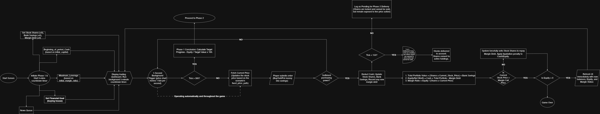
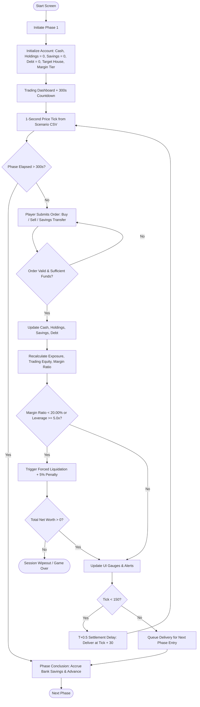

# User Flow and Interface Architecture

This document describes the player journey, phase-by-phase market progression, decision trees, and trading terminal interface for Free Fall 2.0.

---

## 1. Core Loop and Player Journey

The user's core task is managing an active, leveraged portfolio over a 30-minute compressed trading session (1,800 ticks), balancing aggressive wealth accumulation against forced liquidation risk:

```text
Market Event / News Alert → Player Decision (Trade / Hedge / De-leverage)
  → Portfolio Revaluation → Risk State Evaluation → Financial Consequences
  → Visual / Audio Feedback → Next Decision Loop
```

Session path:
`Start Screen → Scenario & Initial Capital Selection → House Target & Margin Tier Choice → Phases 1–6 (Live Trading & Hedging) → Margin Warning / Liquidation Checks → Post-Simulation Risk Review`.

---

## 2. Phase 1 System Workflow Architecture

Designed by Trần Hữu Dụ and implemented in `src/simulation_engine.py`:





---

## 3. Market Phases and Behavioral Mechanics

Each 300-second phase models a specific psychological stage of a speculative market cycle:

| Phase | Duration | Market State | Behavioral & Pedagogical Mechanism |
|:---:|:---:|---|---|
| **Phase 1** | 1–300s | Fake Positive News | Deceptive positive sentiment entices players to deploy initial leverage. |
| **Phase 2** | 301–600s | True Positive News | Realized price gains build overconfidence; players reinforce long positions. |
| **Phase 3** | 601–900s | Bull Market | Broad asset rallies tempt players to increase leverage tiers (3× or 4×) to pursue higher house targets. |
| **Phase 4** | 901–1200s | Strong Growth (FOMO) | Peak speculative borrowing; retail FOMO peaks as prices reach session highs. |
| **Phase 5** | 1201–1500s | Euphoria & Bull Traps | High volatility, false dips, and distribution traps; testing player risk recognition before the crash. |
| **Phase 6** | 1501–1800s | Negative Shock & Cascade | Severe market-wide collapse; cascading margin calls trigger forced liquidations for over-leveraged accounts. |

---

## 4. Player Narrative Paths and Endings

| Archetype Path | Typical Strategy & Allocation | Final Outcome | Narrative Debrief |
|---|---|---|---|
| **Conservative Capital Preservation** | Cash 1.0× only; systematically rotates liquid profits into Safe Haven Bank before Phase 6. | Solvency preserved at ~2.9× initial capital. | **Normie:** Modest real wealth preserved without taking catastrophic downside exposure. |
| **Disciplined Tactical Margin** | 2.0×–3.0× margin during Phases 2–4; aggressive de-leveraging and profit-taking in Phase 5. | Reaches the 20× Normal House target. | **Middle-Class Stability:** Successfully capitalized on market momentum while managing margin risk before the crash. |
| **Aggressive Speculation / Crash Victim** | 4.0× maximum leverage maintained into Phase 6 collapse without cash buffers. | Maintenance breach triggers forced liquidation; equity wiped out. | **Wipeout:** Complete portfolio liquidation with a 5% penalty, illustrating the reality of leverage blindness. |
| **Master Market Timing** | Perfect re-leveraging cycles with whole-share allocations and timely exits before Phase 6. | Reaches the 100× ToLam Villa target. | **Extravagant Luxury:** Theoretical best-case outcome matching the mathematical benchmark. |

---

## 5. Interface Design and Terminal HUD

The web interface is deployed as a high-density, dark-mode financial terminal (`index.html`):

- **Color Palette & Design Tokens:** Base background `#030712`, glass surface overlays `rgba(6, 11, 20, 0.82)`, emerald positive accents `#10B981`, crimson risk alerts `#EF4444`, amber warning banners `#F59E0B`.
- **Primary HUD Panels:**
  1. **Account Overview:** Live displays of Total Net Worth, Liquid Trading Cash, Margin Debt, and Safe Haven Bank Savings.
  2. **Risk Gauges:** Real-time Margin Health gauge with an explicit red 20.00% floor marker, Effective Leverage gauge (0×–5.0×), and Property Wealth Target progress bar.
  3. **Price Board & Interactive Chart:** Live tick series for 50 securities with phase indicators and sector grouping.
  4. **Order Entry Dock:** Asset selection, quantity inputs, Cash vs Margin toggle, Quick Max calculations, and Bank transfer controls.
  5. **Audio-Visual Alert Engine:** Audible warning sirens and pulsing red modal overlays upon Margin Call or Forced Liquidation events.

Accessible live at: [https://ftu-legacy-63.github.io/G06/](https://ftu-legacy-63.github.io/G06/)
