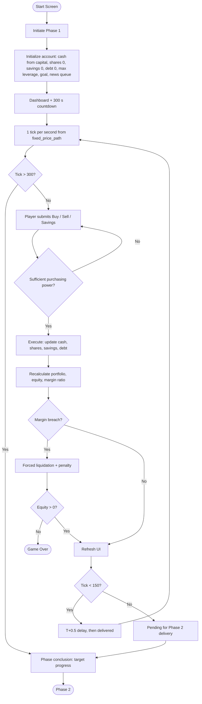

# User Flow

> Consolidated from: `User_flow.md`/`Feature_map.md`, `phase_1_workflow.jpg`, `Solution_Structure.md`, `Sample_Input_Output.md`, midterm interface description. `Interface_design.md` was **empty** in Week 6 — see §6.

## 1. Core goal and loop
Manage a leveraged portfolio through a 30-minute simulated session, pursue a property target and avoid forced liquidation.

`Market event → User decision → Portfolio revaluation → Risk state → Financial consequence → Feedback → Next decision`

Session path: `Start → scenario & capital assigned → choose house target → choose margin tier → Phases 1–6 (trade / save / de-risk) → margin warning → liquidation or survival → Risk & Decision Review`.

## 2. Phase 1 system flow (designed by Trần Hữu Dụ)

Background: news queue and the 1-second price trigger run throughout; savings accrue 4.75 % after each completed AM/PM session.

## 3. Feature decisions (Week 5)
| Decision | Features |
|---|---|
| **Keep (core)** | Scenario & capital assignment, house target and margin tier selection, 1,800 s simulation, phase & news feed, asset selection, order entry/validation/execution, portfolio valuation, net equity, leverage monitor, margin health indicator, pre-liquidation warning, forced liquidation engine, solvency check, cash display, Bank Savings, target progress, order log, post-simulation review |
| **Postpone** | Scenario playback, detailed behavioural classification, advanced performance charts, export result |
| **Remove** | Leaderboard, login (MVP); order-book depth, slippage model, derivatives, multiplayer, live brokerage (out of scope) |

## 4. Phases
| Phase | Seconds | Behavioural mechanism |
|---|---|---|
| 1 Fake Positive News | 1–300 | Deceptive hype baits leveraged exposure |
| 2 True Positive News | 301–600 | Confidence reinforced |
| 3 Bull Market | 601–900 | Players chasing high targets move to 3×/4× |
| 4 Strong Growth (FOMO) | 901–1200 | Peak borrowing |
| 5 Market Euphoria | 1201–1500 | Greed trap, fakeouts, bull traps |
| 6 Negative Shock | 1501–1800 | Crash, leverage ≥ 5× → forced liquidation |

*The earlier README used different phase names (“Slightly Green Market … Margin Cascade”); use the names above.*

## 5. User paths and endings
| Path | Example | Result |
|---|---|---|
| Happy / safe | Small House, cash only, rotate to Bank Savings before Phase 6 | Solvent ≈ 2.92× capital; Normie ending |
| Alternative | Normal House, 2×–3× margin with profit-taking in Phase 5 | Middle-class stability ending (20× target) |
| Critical-risk | ToLam Villa, 4× held into Phase 6 | Margin breach → forced liquidation / wipeout |

Decision matrix: Buy raises exposure (debt if margin used); Sell lowers exposure and returns cash after T+0.5; Hold leaves equity to follow prices; Margin tier sets buying power and debt; Bank Savings lowers exposure and earns 4.75 % per session.

## 6. Phase 1 news and event script (Scenario Designer)
Fixed public market news (does not alter the predetermined price path): **0:00** South Korea's semiconductor outlook strengthens (AI demand, HBM, exports); **2:30** AI infrastructure investment supports Korean chipmakers; **4:00** investor sentiment improves across Korean technology stocks.
Asset-specific news for the five drivers: Vintrumite (AI memory, HBM, 3D memory), Samsung Electronics (AI partnerships, ASML collaboration), KODEX Semiconductor (AI-driven chip demand), KODEX Leverage (≈ 2× KOSPI200 daily exposure), TIGER Semiconductor TOP10 (chipmaker concentration, cycle sensitivity). *Phases 2–6 scripts are not yet written (stated next step).*

## 7. Scenario decision paths
| Scenario condition | Player decision | Input / action | Next path |
|---|---|---|---|
| Positive Phase 1 information | Enter the market | Buy + asset + volume | Keep observing with an active position |
| No wish to change position | Hold | Hold | Next tick with same position |
| Reduce exposure | Sell | Sell | Cash and shares updated |
| Want more purchasing power | Margin tier + margin toggle | `margin_tier` | Higher exposure and margin risk |
| Keep funds out of the market | Bank Savings | `bank_savings` | Funds move to savings; continue |
| Margin condition critical | Buy / Sell / Hold / cash management | Any | Normal continuation, forced liquidation, or Game Over |

Behavioural progression: `Understand leverage → Build confidence → Recognise vulnerability → Respond to warning signs → Manage liquidity & exposure → Reduce liquidation risk`.

## 8. Interface (from contribution evidence; `Interface_design.md` empty)
Dark-mode trading terminal (`#05070A` base, `#00E676`/`#10B981` green, `#EF4444` red, glass panels `#0F172A` at 60 % with `#1E293B` borders, JetBrains Mono). Intro screen with three cards (The Crisis, Our Mission, Your Takeaway) and a *LAUNCH SIMULATOR →* button. Dashboard: Account Overview (net worth, trading cash, margin debt, *Safe Haven Bank*), live tickers, interactive chart, news ticker (bottom left), quick order panel (BUY / SELL / Confirm). Risk panel: Margin Health gauge (red 20 % floor), Leverage gauge (0×–4.0×), Property Target progress bar. Live demo: https://ftu-legacy-63.github.io/G06/ · source: [`index.html`](../index.html), [`web/`](../web). `[TODO: add the UI design-system file and wireframes, or paste screenshots here.]`
